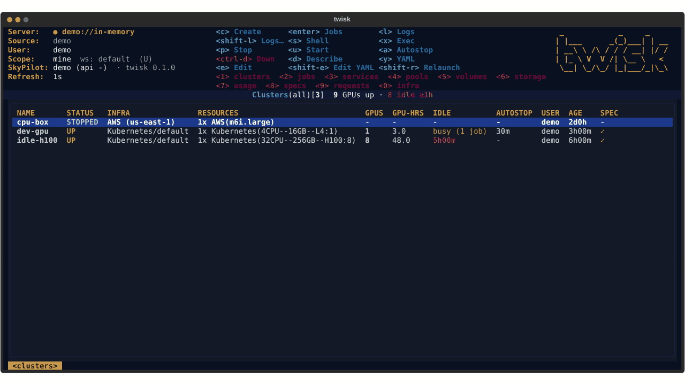
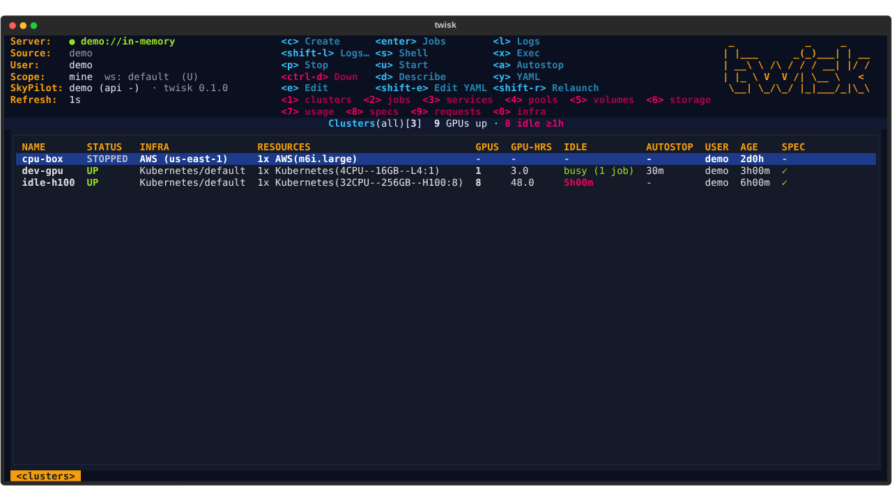
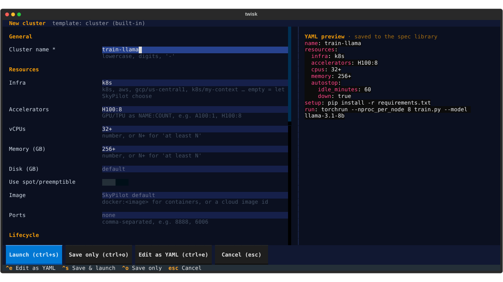
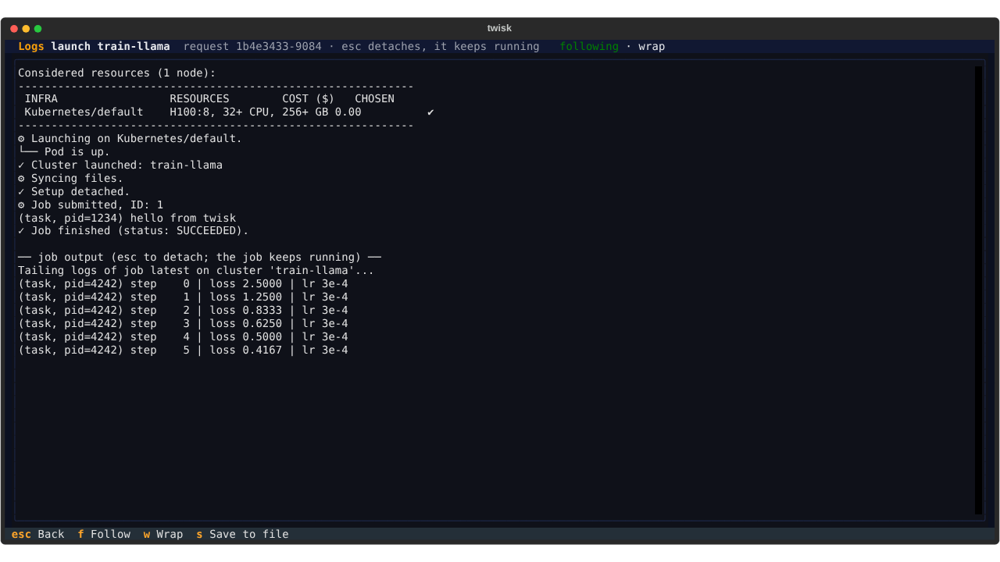
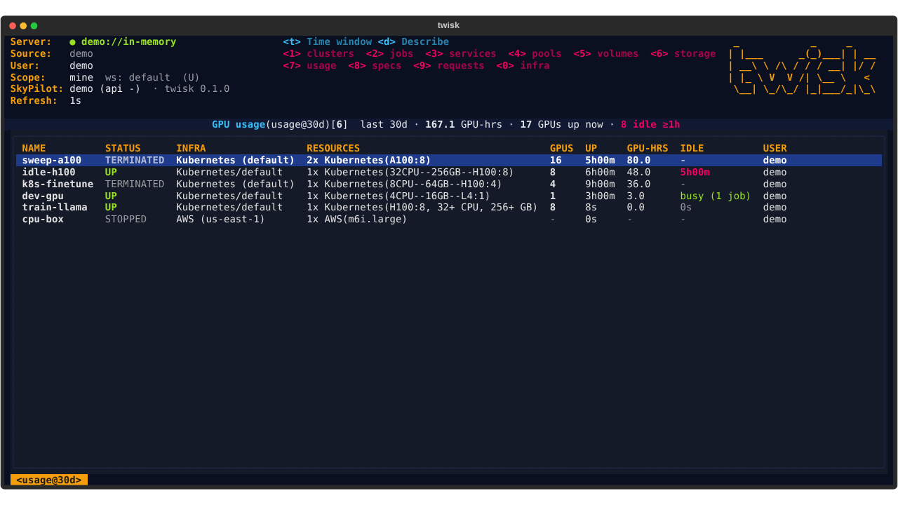
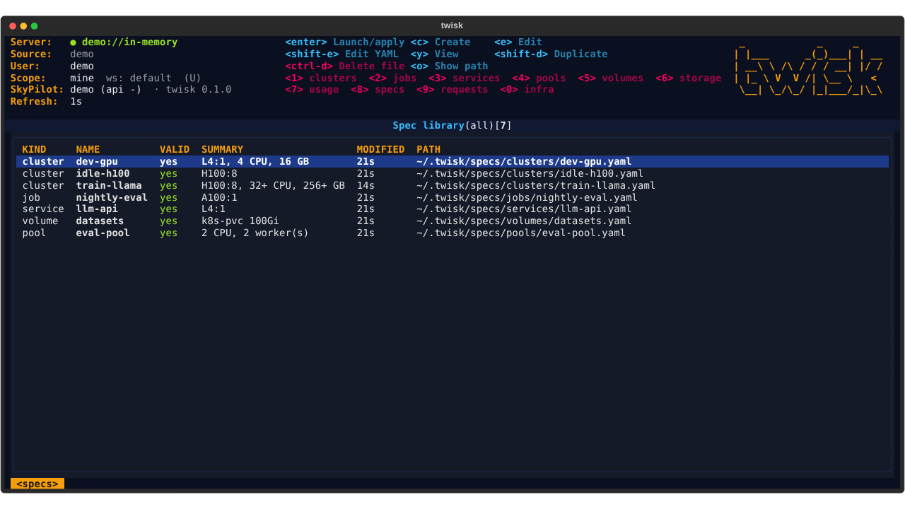
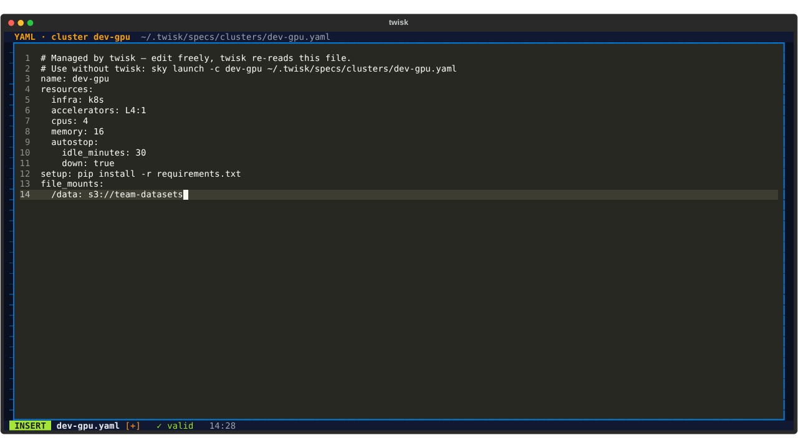
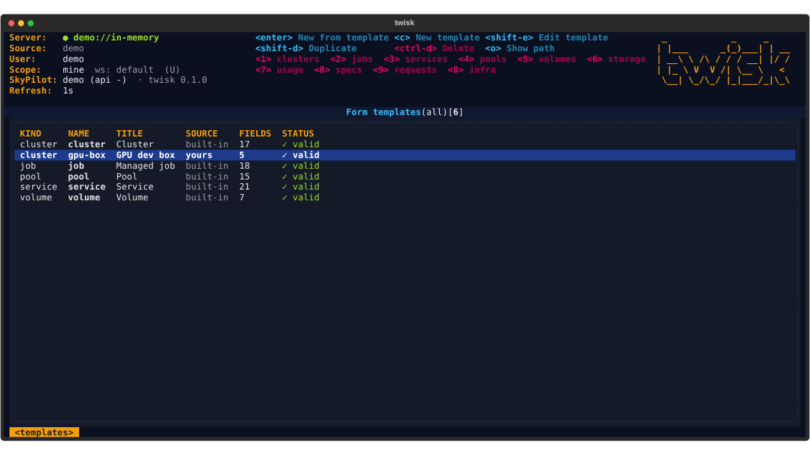
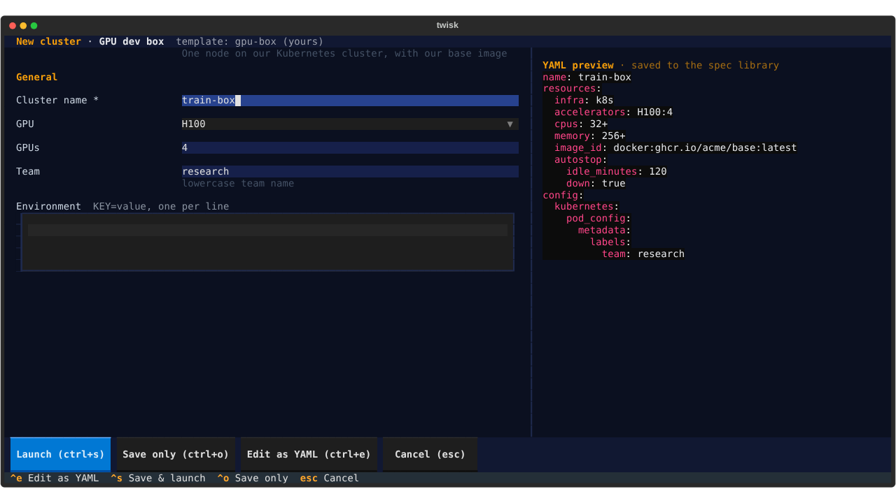

# twisk

**A k9s-style terminal UI for [SkyPilot](https://github.com/skypilot-org/skypilot).** *(twisk = TUI + sky)*
Browse and drive clusters, managed jobs, services and volumes from one keyboard-driven screen, and create them
through forms instead of hand-writing YAML.



<sub>Recorded with `twisk --demo` (an in-memory simulation). Regenerate with `scripts/capture_screenshots.py`.</sub>

## Why

SkyPilot is configured with task YAML. That's powerful, but for day-to-day work you end up keeping a folder of
half-remembered YAML files and a terminal full of `sky status`, `sky logs`, `sky jobs queue`… twisk keeps the power
and removes the bookkeeping:

- **Forms, not YAML.** Press `c` anywhere to create a cluster, managed job, service or volume. Each form validates as
  you type and shows the exact SkyPilot YAML it generates in a live preview pane.
- **Forms you define.** Every form is a template in `~/.twisk/templates` — a list of fields plus a Jinja2 template
  that turns them into SkyPilot YAML. Write your team's "GPU dev box" or "nightly eval" form once; everyone gets a
  form with just the knobs that matter and your defaults baked in. See [Form templates](#form-templates).
- **A spec library you never have to manage, but can.** Everything you create is saved as plain SkyPilot YAML under
  `~/.twisk/specs/<kind>/<name>.yaml`. Press `e` to re-open the form, `E` to edit the YAML in twisk's built-in vim
  editor, `R` to relaunch from it. Fields the form doesn't know about (e.g. `file_mounts`,
  `instance_type`, `config:`) are preserved across form edits. The files work with the plain CLI too:
  `sky launch -c dev ~/.twisk/specs/clusters/dev.yaml`.
- **Everything in one place, live.** Clusters, cluster job queues, managed jobs, services and their replicas, job
  pools and their workers, volumes, storage buckets, GPU usage, in-flight API requests, enabled infra and
  workspaces — auto-refreshing, filterable, sortable.
- **GPU-hours and idle time, not dollars.** Every cluster shows its GPU count, GPU-hours so far and how long it has
  been idle (busy while jobs run; otherwise idle since its last job ended, the same notion SkyPilot's autostop uses).
  GPU clusters idle for an hour or more are flagged red, and the title bar counts GPUs up vs. GPUs sitting idle.
  `:usage` lists GPU-hours per cluster — including torn-down ones — over 1d/7d/30d/all. No prices are shown:
  Kubernetes has none unless an admin configures them. (Interactive SSH sessions aren't visible to twisk, so a
  cluster someone is using only over SSH reads as idle.)
- **Mine vs. everyone, and workspaces.** `U` toggles between your resources and every user's (default: yours, so
  `ctrl-d` isn't one key from a teammate's cluster). `:ws` lists workspaces; `enter` switches the one new launches go
  to (via a SkyPilot project-config overlay — your `~/.sky/config.yaml` is never edited).
- **Knows SkyPilot's sharp edges.** e.g. Kubernetes clusters can only auto-*down*, never stop; a service's port has
  to be both `service.ports` and an opened resource port. twisk checks these as you type — in the built-in forms,
  your own templates and the YAML editor alike — so launches don't fail late.
- **Logs and shells one key away.** `l` streams logs (cluster jobs, managed jobs, controllers, load balancers,
  replicas, API requests). While a cluster comes up, `l` follows its `sky launch` output and `v` tails the
  provisioner log; `s` drops you into an SSH shell on a cluster; `x` runs a command with `sky exec`.
- **Safe by default.** Destructive actions are on `ctrl-d` and always confirm. twisk never auto-starts a local API
  server behind your back; it tells you when the server is unreachable instead.

## Screenshots

| | |
|---|---|
|  |  |
| **Clusters.** GPUs, GPU-hours and idle time per cluster; idle GPU clusters in red, "9 GPUs up · 8 idle ≥1h" in the title. | **Forms, not YAML.** Fill fields, see the exact SkyPilot YAML on the right; `ctrl-s` saves and launches. |
|  |  |
| **Launch logs.** SkyPilot's output streams in, then the job's own output. `esc` detaches; the launch keeps going. | **GPU usage.** GPU-hours per cluster, including torn-down ones, over 1d / 7d / 30d / all. |
|  |  |
| **Spec library.** Everything you create, as plain SkyPilot YAML in `~/.twisk/specs`. | **Escape hatch.** `E` (or `ctrl-e` in a form) opens the YAML in a built-in vim editor; it's validated on `:w`. |
|  |  |
| **Form templates.** Built-in forms and your own, side by side (`:templates`). | **Your own forms.** A team template: five fields, the rest of the YAML baked in. |

## Install & run

twisk is on [PyPI](https://pypi.org/project/twisk/). Install it as a command-line tool with
[uv](https://docs.astral.sh/uv/getting-started/installation/):

```bash
uv tool install twisk
twisk --demo          # try it against an in-memory simulation, no server needed
twisk                 # TUI against your SkyPilot API server
```

uv picks a supported Python (3.10–3.13) by itself. Other ways to get it:

```bash
uvx twisk --demo                                       # run once without installing
uv tool upgrade twisk                                  # update
uv tool install git+https://github.com/roulbac/twisk   # straight from main
pipx install twisk                                     # or with pipx / pip
uv tool uninstall twisk
```

From a checkout (for development), use `uv sync` and prefix commands with `uv run` (`uv run twisk --demo`).

twisk talks to a [SkyPilot API server](https://docs.skypilot.co/en/latest/reference/api-server/api-server.html).
The endpoint is resolved in this order: `--endpoint URL`, `$SKYPILOT_API_SERVER_ENDPOINT`, `endpoint:` in
`~/.twisk/config.yaml`, `api_server.endpoint` in `~/.sky/config.yaml` (what `sky api login` writes), then
`http://127.0.0.1:46580`.

## Try it: the k3s sandbox

`twisk sandbox` gives you a disposable SkyPilot setup on your laptop: a single-node k3s cluster and a SkyPilot API
server wired to it, both in Docker. Nothing touches your real clouds.

```bash
twisk sandbox up       # ~3–5 min the first time (pulls k3s, SkyPilot and the SkyPilot pod image)
twisk                  # the sandbox is now twisk's default endpoint
twisk sandbox status
twisk sandbox start    # after a reboot / Docker restart
twisk sandbox down     # removes everything
```

Requirements: Docker with ~4 CPUs / 8 GB available. In the sandbox use `infra: k8s` (or leave infra empty), keep
requests small (1 CPU / 1–2 GB), and note that Kubernetes clusters can be torn down but not stopped.

| | |
|---|---|
| API server | `http://127.0.0.1:46580` (also usable with the plain `sky` CLI via `SKYPILOT_API_SERVER_ENDPOINT`) |
| kubeconfig | `~/.twisk/sandbox/kubeconfig` (`kubectl --kubeconfig ~/.twisk/sandbox/kubeconfig get pods`) |
| server logs | `twisk sandbox logs` |
| service endpoints | SkyServe load balancers listen on `http://localhost:30001`–`30020` (published from the sandbox) |
| pod images | `twisk sandbox preload [IMAGE…]` side-loads images from your host's Docker into k3s |
| workspaces | `default` and `experiments`, to try workspace switching (`:ws`) |

What `sandbox up` does: starts `rancher/k3s` (API on `127.0.0.1:16443`), starts `berkeleyskypilot/skypilot:0.14.2`
with `sky api start --deploy` in the k3s container's network namespace, gives the server the k3s kubeconfig plus a
small config (managed-jobs/serve controllers run inside the API server; pods use `imagePullPolicy: IfNotPresent`),
pre-loads SkyPilot's pod image into k3s from your host's Docker cache (so recreating the sandbox doesn't re-download
it), runs `sky check kubernetes`, and points twisk at it. It detects cgroup-v1 hosts and nested-container hosts that
forbid lowering `oom_score_adj` and adjusts k3s accordingly.

The sandbox is one k3s node with whatever CPUs Docker gives it. If a launch sits in INIT or fails with
"Failed to acquire resources", the node is full: tear down clusters/services you no longer need (`ctrl-d`).

Behind a TLS-intercepting corporate proxy, pass a CA bundle that includes your proxy's CA:
`twisk sandbox up --ca-bundle /path/to/ca-bundle.crt`. It is trusted by k3s (image pulls), the API server (catalog
downloads) and every SkyPilot pod (pip/uv/curl during runtime setup).

## Keys

| Global | |
|---|---|
| `:` | command mode: `:clusters` `:jobs` `:services` `:pools` `:volumes` `:storage` `:usage` `:specs` `:requests` `:infra` `:ws` `:templates` `:q` (aliases: `cl`, `mj`, `svc`, `pl`, `vol`, `st`, `gpu`, `sp`, `req`, `tpl`, …) |
| `1`–`9`, `0` | jump to a view: clusters, jobs, services, pools, volumes, storage, usage, specs, requests, infra |
| `j` `k` · `g` `G` | move down / up · to top / bottom (arrows work too) |
| `U` | scope: only my resources ⇄ every user's |
| `/` | filter rows, `esc` clears |
| `<` `>` | sort by previous/next column (again to reverse) |
| `ctrl-r` | refresh now (on clusters: ask the clouds for fresh status) |
| `esc` / `q` | back (q quits at the top level) · `?` help · `ctrl-c` quit |

| Clusters | | Managed jobs | |
|---|---|---|---|
| `c` | create (form) | `c` | submit (form) |
| `enter` | job queue on the cluster | `l` / `enter` | job logs |
| `l` | logs: the launch while it runs, else the latest job | `L` | controller logs |
| `s` | SSH shell | `ctrl-d` | cancel |
| `x` | `sky exec` a command | `R` | resubmit from spec |
| `p` / `u` | stop / start | | |
| `a` | autostop / autodown | **Services** | |
| `ctrl-d` | tear down | `enter` | replicas (`l` logs, `ctrl-d` terminate) |
| `d` / `y` | describe / YAML | `l` / `L` | load balancer / controller logs |
| `e` / `E` | edit spec in form / as YAML | `e` / `R` | edit, rolling update |
| `R` | relaunch from spec | `ctrl-d` | tear down |
| `i` | import the server's YAML into the library | | |
| `L` | pick logs: launch request · provisioner · latest job | | |
| `v` | provisioner log (`provision.log`, follows while INIT) | | |

| Spec library (`8`) | | Requests (`9`) | |
|---|---|---|---|
| `enter` | launch / apply | `enter` | follow logs |
| `e` / `E` | edit in form / as YAML | `ctrl-d` | cancel |
| `D` | duplicate | | |
| `ctrl-d` | delete the file | **Forms** | |
| `o` | show (and copy) the path | `ctrl-s` | save spec + launch/apply |
| | | `ctrl-o` / `ctrl-e` | save only / continue in the vim editor |
| | | `c` (any view) | new resource; asks which form if a kind has several templates |

| Pools (`4`) | | GPU usage (`7`) | |
|---|---|---|---|
| `c` | create (form) | `t` | cycle window: 1d / 7d / 30d / all |
| `enter` | workers (`l` worker logs) | `d` | describe |
| `l` | controller logs | **Storage (`6`)** | |
| `ctrl-d` | tear down | `ctrl-d` | delete bucket (and its objects) |
| `e` / `R` | edit / re-apply (rolling) | **Workspaces (`:ws`)** | |
| | | `enter` | switch the active workspace |

| Volumes (`5`) | | Form templates (`:templates`) | |
|---|---|---|---|
| `c` | create (form) | `enter` | new resource from the template |
| `ctrl-d` | delete (and its data) | `c` | new template from a working example |
| `d` / `y` | describe / YAML | `E` | edit in the vim editor (a built-in saves your copy) |
| `e` / `E` | edit in form / as YAML | `D` | duplicate |
| `R` | re-apply | `ctrl-d` | delete yours (a built-in it replaced comes back) |
| `i` | import the server's YAML | `o` | show (and copy) the path |

Managed jobs have a **Run in pool** field: set it to submit the job to a pool's warm workers instead of
provisioning a cluster (`sky jobs launch --pool`). Since the pool isn't part of SkyPilot's task YAML, the spec file
records it in a `# twisk: pool=<name>` header comment.

Log views: `f` toggle follow, `w` toggle wrap, `s` save to `~/.twisk/logs/`, `esc` detach (the work keeps running).

## Editing YAML (the escape hatch)

The forms cover the common fields. For anything else — `file_mounts`, `config:` overrides, a custom
`instance_type`, an extra `service` option — edit the YAML directly, without leaving twisk:

- **An existing resource or spec:** select it and press `E` (works in clusters, jobs, services, pools, volumes and
  the spec library). Resources created outside twisk are seeded from the YAML the server recorded.
- **A resource you're about to create:** fill what you can in the form, then `ctrl-e` to continue in the editor.
  Nothing is written until `:w`, so `:q!` leaves no trace.

The editor is a vim inside the TUI (normal / insert / visual modes; no vim binary needed):

| | |
|---|---|
| `:w` · `:wq` (`ZZ`) · `:q` · `:q!` (`ZQ`) | save · save & close · close (refuses with unsaved changes) · discard |
| `:apply` or `ctrl-s` | save, then launch the cluster / submit the job / roll out the service / apply the volume or pool |
| `i a I A o O`, `esc` | insert modes (`o`/`O` keep YAML indentation, one level deeper after `key:`), back to normal |
| `h j k l w b e 0 ^ $ gg G`, `ctrl-d/u` | motions, with counts (`3j`, `2w`, `5G`) |
| `d c y > <` + motion, `dd yy cc >> <<` | operators on a motion or on lines |
| `x X D C s S J r p P ~` | the usual single-key edits |
| `v`, `V` | visual / visual-line selection, then an operator |
| `u`, `ctrl-r` | undo / redo (one step per change) |
| `/pattern`, `n`, `N` · `:42` | search (regex) · go to line |

The status line shows the mode, unsaved changes (`[+]`) and whether the YAML is valid as you type; invalid YAML is
never written. Prefer your own editor? Set `editor: nvim` (or `editor: $EDITOR`) in `~/.twisk/config.yaml` and `E`
will suspend twisk and open it instead.

## Form templates

Every create/edit form in twisk is generated from a **template**: a YAML file that lists the form's fields and a
[Jinja2](https://jinja.palletsprojects.com/templates/) template that turns the field values into SkyPilot YAML.
twisk ships one per kind (`cluster`, `job`, `service`, `pool`, `volume`); yours live in `~/.twisk/templates/`.

```yaml
# ~/.twisk/templates/gpu-box.yaml
kind: cluster                     # cluster | job | service | pool | volume
title: GPU dev box
description: One node on our Kubernetes cluster, with our base image
fields:
  - {key: name, label: Cluster name, required: true}     # every template needs `name`
  - key: gpu
    label: GPU
    type: select
    options: [L4, A100, H100]
    default: L4
  - {key: gpus, label: GPUs, type: int, default: 1, min: 1, max: 8}
  - {key: team, label: Team, pattern: "[a-z]+", help: lowercase team name}
  - {key: env, label: Environment, type: kv, help: "KEY=value, one per line"}
template: |
  name: {{ name }}
  resources:
    infra: k8s
    accelerators: {{ gpu }}:{{ gpus }}
    cpus: {{ gpus * 8 }}+
    memory: {{ gpus * 64 }}+
    image_id: docker:ghcr.io/acme/base:latest
    autostop: {idle_minutes: 120, down: true}
  envs: {{ env | yaml }}
  
  config:
    kubernetes:
      pod_config: {metadata: {labels: {team: {{ team | yaml }}}}}
  
```

With that file in place, `c` in the clusters view asks which form to use; pick *GPU dev box* and you get exactly
those five fields, with the rendered YAML live next to them.

**Fields**

| | |
|---|---|
| `key` | variable name in the template (letters, digits, `_`) |
| `type` | `text` · `area` (multi-line) · `int` · `float` · `bool` · `select` · `list` (comma-separated → list) · `kv` (`KEY=value` lines → mapping) |
| `label`, `section`, `help`, `placeholder` | how it shows in the form (fields are grouped by `section`) |
| `default`, `required` | starting value; required fields can't be left empty |
| `options` | for `select`: `[a, b]` or `[{label: …, value: …}]` (a value of `""` means "leave it out") |
| `min`, `max`, `pattern` | validation for numbers / text (`pattern` is a full-match regex; `help` is shown as the error) |
| `suggest` | completions: a list, or `infra` · `accelerators` · `volumes` · `pools` (live from your server) |
| `path` | where the field lives in the YAML (`resources.cpus`, alternatives as `a|b`). Lets twisk fill the form from YAML it didn't render (e.g. a cluster created with `sky launch`) and attach SkyPilot validation errors to the right field. `twisk.pool` stores a job's pool. |

**Templates**

- Field values are variables; empty optional fields are `none`. `{{ x | yaml }}` renders any value as YAML (strings
  get quoted, `kv` fields become mappings), and keys whose value comes out null or empty are dropped — so optional
  fields rarely need ``.
- The output is validated like any spec: SkyPilot rules (`cpus: 4+`, `A100:8`, Kubernetes can't stop clusters, …) are
  checked as you type, and unknown SkyPilot keys (`file_mounts`, `config`, …) pass straight through.
- Templates run in Jinja2's sandbox.

**Managing them**

- `:templates` in the TUI lists every template and whether it's built-in, yours, or yours overriding a built-in.
  `enter` creates a resource from it, `c` starts a new template from a working example, `E` edits one in the vim
  editor (it's validated on `:w`; editing a built-in saves your copy), `D` duplicates, `ctrl-d` deletes yours.
- A file named after a kind (`~/.twisk/templates/cluster.yaml`) **replaces that built-in form**.
  `twisk templates init` copies all the built-ins there as a starting point.
- `twisk templates list` / `validate` / `path` from the shell.

**Editing later.** Specs remember which template and values made them, so `e` reopens the same form filled in.
Changes you made in the YAML editor in the meantime are kept: twisk does a three-way merge between the file, what
the form rendered last time, and what it renders now — anything the form doesn't produce survives, and anything you
change in the form wins.

## Layout

```
  src/twisk/
    specs/        typed specs ⇄ SkyPilot YAML, and the on-disk spec library
    backend/      Backend protocol; skypilot.py (SDK, API-server mode) and fake.py (demo/tests)
    templates/    form templates: model, engine (render/validate/merge), registry, builtin/*.yaml
    tui/          Textual app: views.py (resource tables), screens/ (form, vim editor, …), widgets/
    sandbox.py    k3s + SkyPilot API server sandbox
    cli.py        `twisk`, `twisk sandbox …`, `twisk specs …`, `twisk templates …`
  tests/          unit + Textual pilot tests (fake backend); `-m sandbox` for live checks
  scripts/        capture_screenshots.py — regenerates docs/assets (README screenshots + GIF)
```

## Development

```bash
uv sync
uv run pytest                    # unit + TUI tests (fake backend, ~1.5 min)
uv run pytest -m sandbox         # live checks against a running `twisk sandbox`
```

### Screenshots and the demo GIF

`scripts/capture_screenshots.py` drives the real TUI against the demo backend, exports Textual screenshots and
renders them with Playwright + Pillow into `docs/assets/`. Rerun it after UI changes and look at the GIF before
committing:

```bash
uv sync --group docs
uv run playwright install chromium   # once
uv run python scripts/capture_screenshots.py
```
